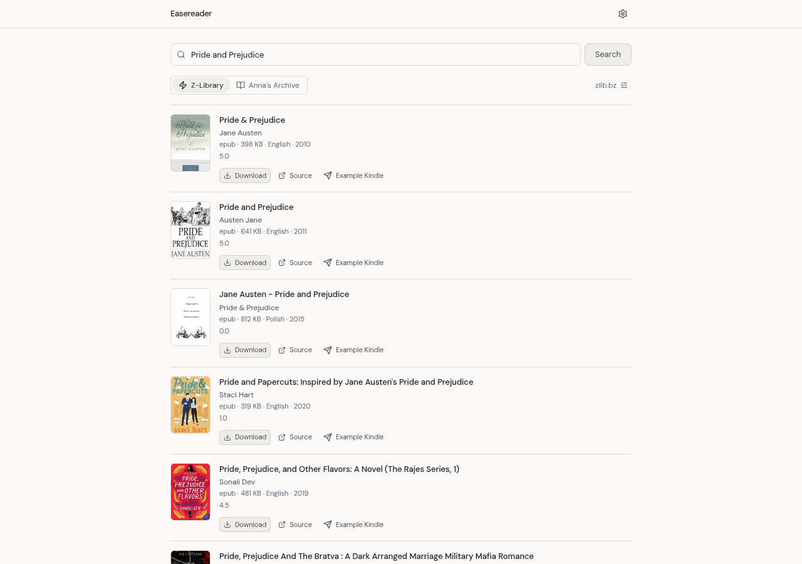
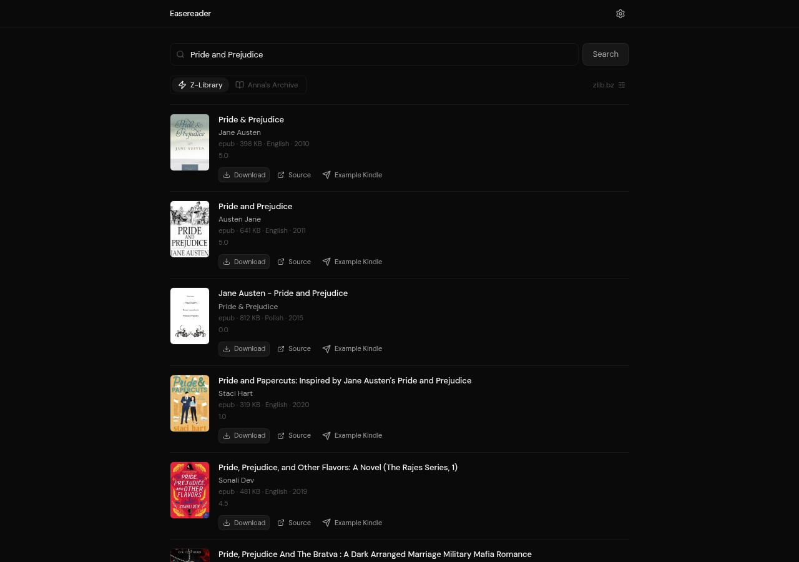
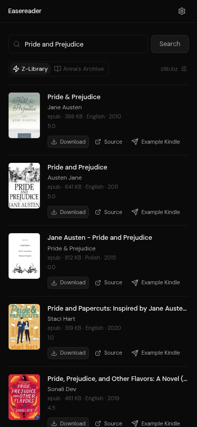

# Easereader

Search for EPUB books and send them to a reading device using an SMTP sender and a device profile. Easereader supports Z-Library and Anna's Archive, and offers light and dark themes.

## Run with Docker

```bash
docker build -t easereader .
docker run --rm -p 3000:3000 -v easereader-config:/config easereader
```

Open <http://localhost:3000>. The volume stores senders, profiles and uploaded profile images. SMTP passwords are stored in the configuration directory, so keep backups private.

### Upgrading an existing installation

Back up the existing configuration first. Reuse the same volume or bind mount at `/config` when replacing the image; this keeps senders, profiles, their images and stored passwords. The storage format is unchanged and no data conversion is required. A changed Compose project name can result in a different named volume, so check the actual volume being mounted.

The active source and selected domains are saved in browser storage. Existing selections are preserved when they remain available in `BOOK_SOURCE_OPTIONS`. Browser storage is tied to the address, so changing host, port or protocol starts with a fresh set of browser preferences. New installations retain the original Anna's Archive default.

## Run locally

Install backend dependencies and build the frontend before starting the application:

```bash
npm ci
cd frontend
npm ci
npm run build
cd ..
npm start
```

Open <http://localhost:3000>. Without the frontend build, the backend API is available but `/` does not serve the app. Data defaults to `data/`; set `CONFIG_DIR` to use another directory and `PORT` to change the listening port.

For frontend development, run the backend with `npm start`, then run `npm run dev` in `frontend/`. Vite serves <http://localhost:5173> and proxies `/api`, `/uploads`, and `/ws/download-progress` to the backend.

Run the backend integration tests with `npm test`. In `frontend/`, run `npm run typecheck`, `npm run lint`, `npm test` and `npm run build`.

## Sender and profile setup

Open Settings, add an SMTP sender, then add a device profile with its delivery email address. Search for a book and use the profile button to send it. Your reading service may require the sender address to be approved first.

Available book source URLs are defined in `BOOK_SOURCE_OPTIONS` in `server.js`. The backend accepts only URLs listed there.

## Screenshots

Screenshots show an example profile and search results for *Pride and Prejudice*.




